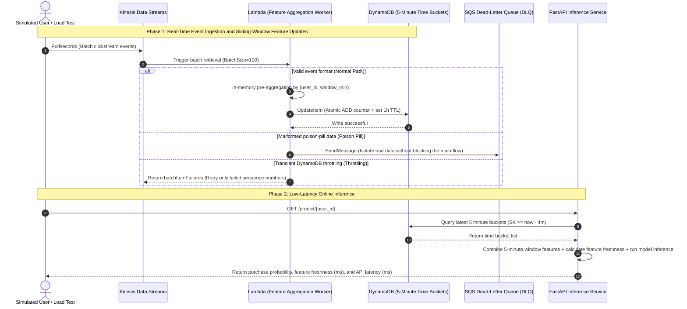

# Realtime_elt_pipeline_project
Real-time clickstream feature engineering and ML inference pipeline on AWS (Kinesis, Lambda, DynamoDB, FastAPI, CDK). Features 1-min time-bucketed sliding windows with atomic counters, partial batch failure handling via SQS DLQ, and sub-50ms online inference.

